# 🚲 Cycle Routes

**Safe, fun bike rides and walks, generated automatically from open data, rated on
everything that matters, and ready for your computer, your phone or paper.**


Most route planners find you the *shortest* way. Cycle Routes looks for the way you'd
actually *want* to ride. It downloads street data and a dozen other open datasets for an
area, scores **every street** for traffic stress, safety, traffic volume, scenery, shade,
hills, surface and speed, and then generates routes for you:

- **A→B** journeys, one per riding style
- **loops** of any length
- **suggested rides** from parks and the city centre
- **trips with stops**, such as a café halfway, water every third of the way, or an
  ice-cream stop

Each route gets a 0–10 score on every factor. You can compare routes side by side, ride
them with voice guidance, print them, or export them to your GPS.

The prototype is built and tested on **Austin, Texas**, where city, state and federal open
data add measured traffic counts, crash records, sidewalks and live road works. The core
works in any city covered by OpenStreetMap.

<p align="center">
  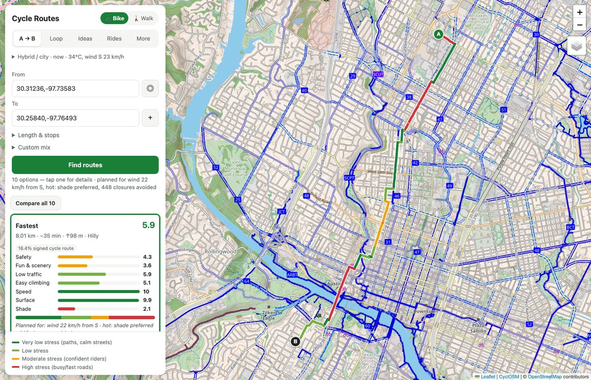
  <br><em>Ten rated options for one journey. The route line is coloured by traffic stress:
  dark green for paths and calm streets, red for busy, fast roads.</em>
</p>

---

## Contents
- [Highlights](#highlights)
- [Feature tour](#feature-tour)
- [How it works](#how-it-works)
- [Quick start](#quick-start)
- [Using it on a phone](#using-it-on-a-phone)
- [Command line](#command-line)
- [Open data sources](#open-data-sources)
- [Project structure](#project-structure)
- [Testing](#testing)
- [Limitations & roadmap](#limitations--roadmap)
- [Contributing](#contributing)
- [Credits & licences](#credits--licences)

## Highlights
| | |
|---|---|
| 🛡️ **Safety first** | Level of Traffic Stress for every street, adjusted with measured traffic, city comfort ratings, crash history and risky crossings |
| 🎯 **Many riding styles** | Fastest, safest, family, scenic, trails, mountain-bike, flattest, quiet, shady, balanced, or your own custom mix |
| ☕ **Length & stops** | "About 30 km with a café and two water stops." Real places are spread evenly along the route |
| 🚶 **Walking too** | Commutes, urban adventures, sightseeing tours, hikes, green & quiet, shady, step-free |
| 🌦️ **Live conditions** | Wind, heat, darkness, road-work closures and rider hazard reports all change the route |
| 🧭 **Get there / extend** | Ride to any suggested or saved route, turn it into a loop, or add stops and a destination |
| 🔊 **Turn-by-turn** | Voice guidance with a choice of voice, speed, detail and chime; live location sharing; ride recording |
| 🖨️ **Print & export** | A4 map with cue sheet and elevation, strip maps, handlebar cue card with QR code, GPX |
| 📴 **Works offline** | Vector map, suggested rides and your data stored on the device |

## Feature tour

### Rated routes for every riding style
Pick a start and a destination. You get one route for each style, near-duplicates merged,
all rated side by side. Set your **bike type** (road, gravel, MTB, e-bike, cargo, kids) and
**departure time** (after dark, lit streets are preferred). **Live wind and heat** add
headwind and shade weighting, and today's **road-work closures** are avoided
automatically. **Compare all** puts every option in one table. With **Custom mix** you set
the weights yourself.

### Road choices: bike lanes only, avoid busy roads
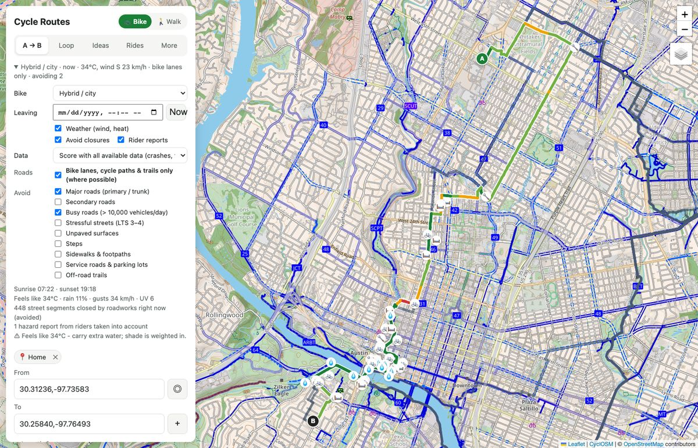

You can avoid major, secondary or busy roads (by measured traffic), stressful streets,
unpaved surfaces, steps, sidewalks, service roads or trails. You can also ask for **bike
lanes, cycle paths & trails only (where possible)**. Protected lanes beside major roads
aren't counted as "avoided", and any stretch the route can't avoid is reported on the
route card. Greenbelt and mountain-bike trails are included, with *Trails & greenways*
and *Mountain-bike trails* styles and a trails map layer.

### Routes of any length, with the stops you want
<table><tr>
<td width="50%">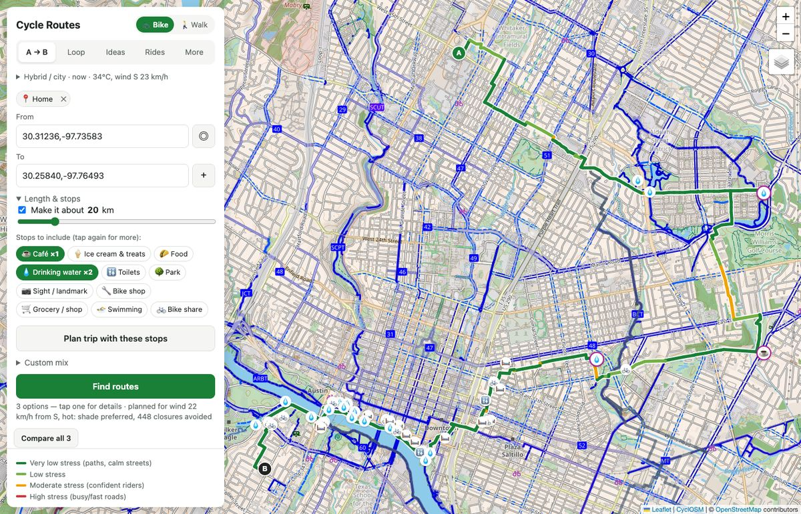</td>
<td width="50%">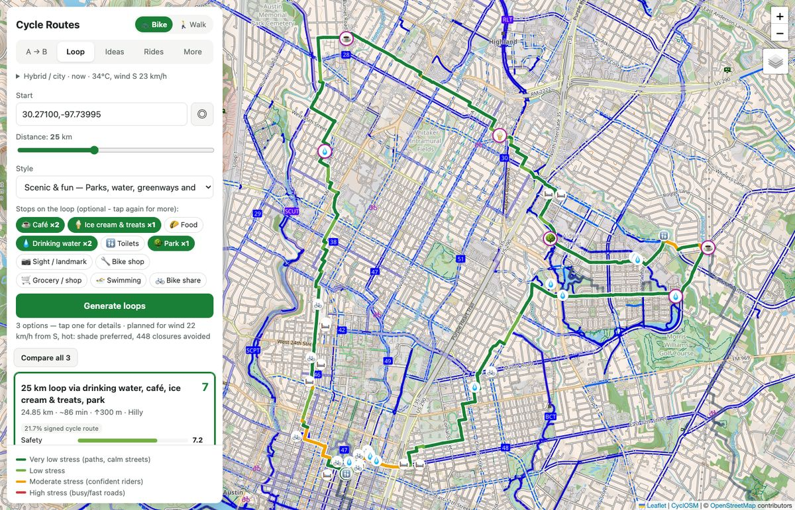</td>
</tr><tr>
<td><em>A→B, stretched to about 20 km, via a café and two water stops</em></td>
<td><em>A 25 km loop with two cafés, ice cream, two water stops and a park</em></td>
</tr></table>

- **A→B:** *Make it about N km* stretches the journey by taking a scenic detour.
- **Loops:** choose any distance from the start.
- **Stops:** tap chips to add stops: café, ice cream & treats, food, drinking water,
  toilets, park, sight, bike shop, grocery, swimming and bike share. Tap again for 2 or 3.
  Real places near the route are chosen, spread evenly, and pinned on the map and the
  route card.

### Get there, loop back, carry on
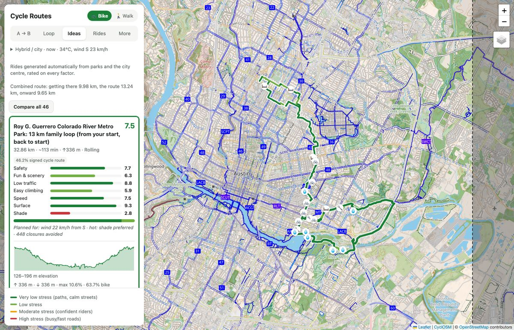

The 🧭 button on any route card (suggested rides, saved routes, tours, loops) plans how
to get there:

- **Start** from your location, a tapped point or a saved place.
- **Join** at the route's start or its nearest point. Loops can be joined anywhere.
- **Afterwards**, finish there, **return to your start** or **continue to a destination**,
  with extra stops on the way.

The getting-there and onward parts are drawn dashed, and the whole trip is rated,
navigable, printable and saveable.

### Walking routes and sightseeing tours
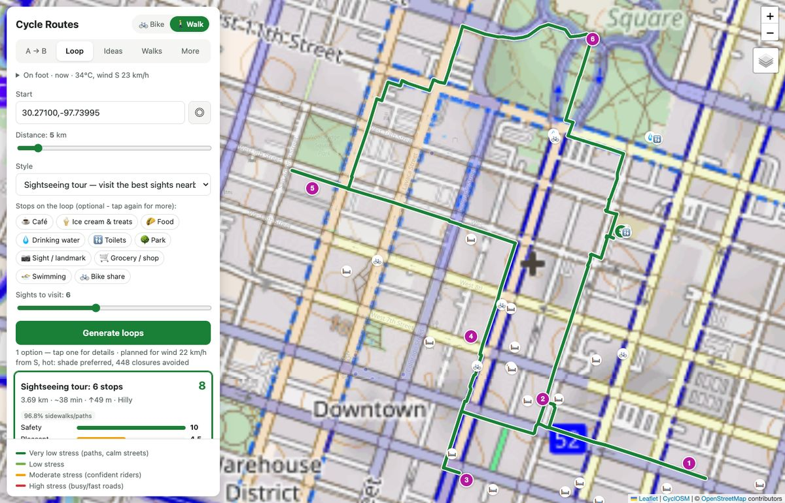

Switch **🚲 Bike / 🚶 Walk** at the top. Walking uses its own network (sidewalks,
footways, steps, pedestrian streets, shared paths) scored for people on foot:

- pedestrian stress
- pedestrian crash records
- the city's sidewalk inventory and condition ratings
- shade, noise, street life and nearby sights

Walking times follow Tobler's hiking function. The trip types are *Commute, Urban
adventure, Sightseeing, Hike, Green & quiet, Shady stroll, Step-free* (for wheelchairs and
strollers) and *Safest*. **Sightseeing tours** visit the best sights nearby in a sensible
order.

### On your phone: navigation, voice and recording
<table><tr>
<td width="33%">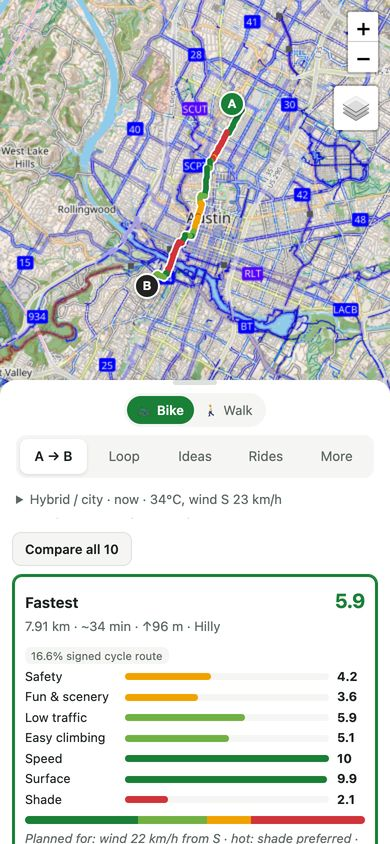</td>
<td width="33%">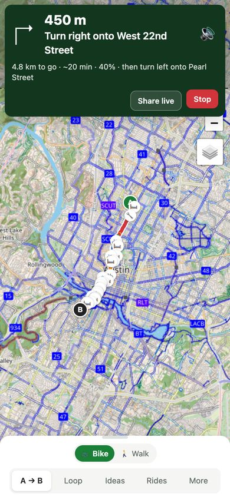</td>
<td width="33%">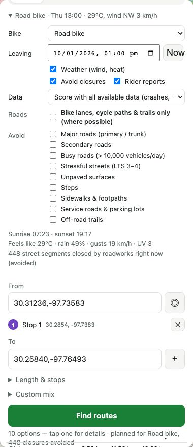</td>
</tr><tr>
<td><em>Results in a bottom sheet</em></td>
<td><em>Turn-by-turn, with reroute and live sharing</em></td>
<td><em>Bike, time, conditions and road choices</em></td>
</tr></table>

- **Ride this route:** a turn-by-turn banner, off-route warnings, one-tap reroute, the
  screen kept awake, and a **share live location** link.
- **Voice guidance** (*More › Voice guidance*):
  - any installed voice, with speed, pitch and volume
  - how much it says: turns only, normal, or with progress updates at 25/50/75%
  - an optional chime and a test button
- **Record a ride** and **My rides:** GPS tracks, GPX/CSV export, ratings for the streets
  you actually rode, and a heatmap of how much of the network you've covered.
- **External GPS:** a USB/serial NMEA receiver (see `hardware/gps_i2c_serial`) or the pyNav
  iPhone tracker.

### Printable maps
<table><tr>
<td width="65%">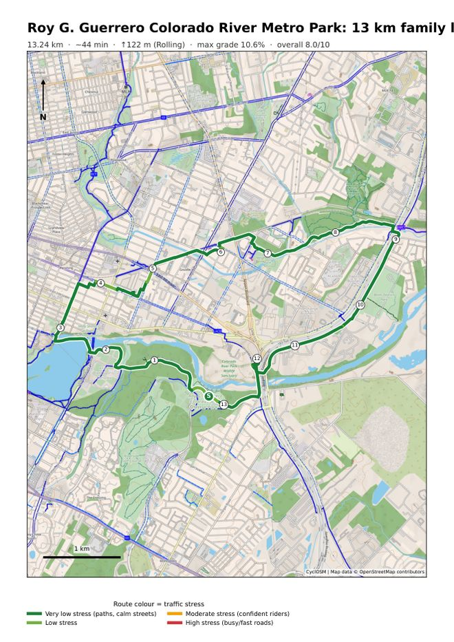</td>
<td width="35%">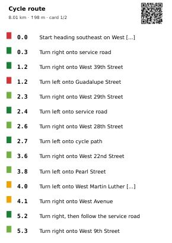</td>
</tr><tr>
<td><em>A4 overview map with legend, scale and numbered turns (the second page has the
ratings, elevation profile and cue sheet)</em></td>
<td><em>A6 handlebar cue card; its QR code links to the GPX</em></td>
</tr></table>

You can print at auto scale or at a fixed 1:10k or 1:25k, and long rides can use strip
maps. **GPX** exports carry elevation and turn cues for Garmin and Wahoo.

### And more
- **Stops along the way:** water, toilets, bike shops, bike share with live bike counts,
  cafés, sights and places to stay, plus the longest stretch without water.
- **Weather warnings** and **multi-day stages** for long rides.
- **Community & personal:**
  - press and hold the map to report a hazard (pothole, glass, close pass, flooding…),
    rate a street 👍/👎 or save a place
  - ★ save routes, and 🔗 share links that re-plan the route
  - "route like I usually ride" learns from the routes you actually ride
- **Open-data map layers:** traffic stress, trails, amenities, places, bike share, live
  road works, crashes, bike counters and hazard reports. *More* also shows the area's
  **low-stress network score**.
- **Offline & local data:** the area's vector map, suggested rides and your data can be
  saved on the device. *Export my data / Import backup* moves everything between machines.
- **Dark mode** follows your system setting.

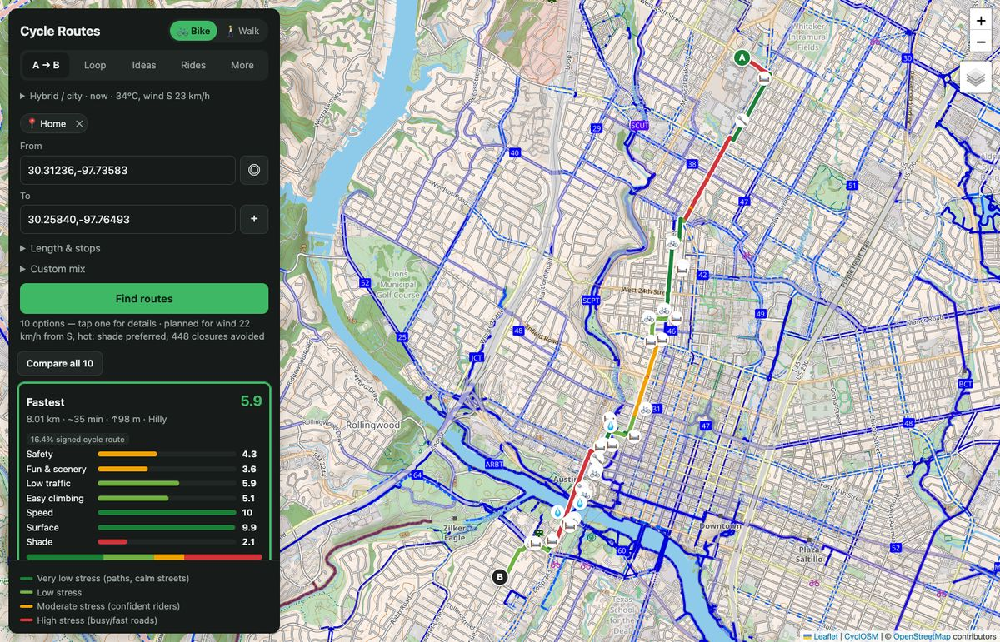

## How it works
```
 OpenStreetMap extract / Overpass ──┐
 Elevation (USGS 3DEP / Copernicus) ┤                      ┌─ A→B alternatives per style
 Tree canopy · traffic noise ───────┤   score every        ├─ loops of any length
 Measured traffic (TxDOT AADT) ─────┼─► street segment ──► ├─ trips with stops
 City crashes · comfort · sidewalks ┤   (LTS, safety,      ├─ suggested rides & tours
 Overture places · OSM amenities ───┘   fun, hills, …)     └─ get there / extend
                                             ▲                        │
 Live: weather · road works · hazards ───────┘ route context          ▼
                                                    web app · PDF · GPX · navigation
```
1. **Build an area** (`cycleroutes build`). Streets come from a local OSM extract (BBBike,
   read with osmium in about a minute) or the live Overpass API. Each open dataset that
   covers the area is downloaded, cached and joined to the street segments.
2. **Score.** Level of Traffic Stress is derived from lanes, speed limits and bike
   infrastructure, then refined with measured traffic and the city's comfort ratings.
   Safety, quietness, fun, surface, climbing, shade and speed scores follow.
3. **Route.** Dijkstra on the street graph runs with a cost that mixes the style's weights
   and your context (bike, darkness, wind, heat, closures, reports, roads to avoid). Loops,
   stretched trips and stops are built on the same router.
4. **Rate & present.** Each route is rated 0–10 on every factor, with the open-data facts
   behind the rating (crashes, busiest traffic, noise, crossings, trail share).

## Quick start
```bash
git clone https://github.com/gddickinson/cycle-routes.git && cd cycle-routes
python3 -m venv .venv && .venv/bin/pip install -e '.[dev]'

.venv/bin/cycleroutes build          # Austin, 10 km radius: streets + all open data
.venv/bin/cycleroutes walk           # optional: the walking network for the same area
.venv/bin/cycleroutes catalog        # optional: suggested rides
.venv/bin/cycleroutes offline        # optional: store the vector map locally
.venv/bin/cycleroutes serve          # → http://127.0.0.1:8000
```
Another city:
```bash
cycleroutes build --name bath --lat 51.381 --lon -2.359 --radius 5000
cycleroutes serve --region bath
```
Datasets that don't cover an area are skipped, and elevation falls back to Copernicus.
Choose sources with `--network extract|overpass --elevation 3dep|copernicus [--refresh]`,
or in the app under *More › Data sources*.

**Docker:**
```bash
docker build -t cycleroutes .
docker run --rm -v "$PWD/data_cache:/app/data_cache" cycleroutes build
docker run --rm -p 8000:8000 -v "$PWD/data_cache:/app/data_cache" cycleroutes
```

## Using it on a phone
Browsers only allow GPS over HTTPS, so start the server with
`cycleroutes serve --host 0.0.0.0 --https` and open `https://<your-computer-ip>:8000`
(accept the certificate warning once). Add it to your home screen to install it as an
app. *More › Save map & data on this device* makes it work without signal.

## Command line
```bash
cycleroutes route --from 30.2672,-97.7431 --to 30.2489,-97.7700 --pdf route.pdf --gpx route.gpx
cycleroutes loop  --start 30.2625,-97.7463 --km 20 --profile scenic --pdf loop.pdf
cycleroutes sources      # re-apply the extra open data to a built area
cycleroutes amenities    # refresh water / toilets / bike shops
cycleroutes gps          # find and test a USB GPS receiver
cycleroutes screenshots  # drive the app in headless Chrome and check it
```
Run `cycleroutes <command> -h` for all options.

## Open data sources
All sources are keyless and open, and each is applied only where it has coverage.

| What | Source | Coverage |
|---|---|---|
| Streets, paths, bike lanes, speeds, lanes, surface, lighting, signed cycle routes | OpenStreetMap (BBBike extract or Overpass) | global |
| Bike shops, water, toilets, repair, parking | OpenStreetMap amenities | global |
| Cafés, food, sights, places to stay | Overture Maps places | global |
| Elevation | USGS 3DEP bare-earth lidar; Copernicus GLO-30 elsewhere | US / global |
| Tree shade | Meta/WRI 1 m canopy height | global |
| Road & aviation noise | US DOT National Transportation Noise Map | US |
| Measured traffic volumes | TxDOT AADT count stations | Texas |
| Bike & pedestrian crashes, bike-comfort ratings, sidewalks, bike counters, live road works | City of Austin open data | Austin |
| Bike share availability | CapMetro GBFS | Austin |
| Weather | Open-Meteo | global |
| Basemaps & search | CyclOSM / OpenStreetMap tiles, Protomaps (offline), Nominatim | global |

Downloads are cached in `data_cache/` and reused wherever they cover the area. A new area
inside an existing one is simply cut from it. Per route, you can score with **all
available data** or **OpenStreetMap only**.

Not used, because they need sign-up or aren't open: Strava, Mapillary, OpenRouteService,
TxDOT DriveTexas, and Garmin/Wahoo developer APIs.

## Project structure
```
cycleroutes/
  data/        download, cache and join open data; build cycling & walking networks
  scoring/     traffic stress, safety, fun, walking scores
  routing/     router, loops, trip planner, tours, get-there/extend, ratings, directions
  api/         FastAPI app and endpoints
  export/      PDF maps, cue cards, GPX
  tracking/    GPS providers, ride store, navigation, map matching
  offline/     local vector basemap, backups
  devtools/    automated screenshot tests
web/           Leaflet client, PWA and service worker (no build step)
tests/         offline unit & API tests
hardware/      Arduino NMEA GPS sketch
```
[INTERFACE.md](INTERFACE.md) maps every module and its key functions, and
[SESSION_LOG.md](SESSION_LOG.md) records how the project developed.

## Testing
```bash
.venv/bin/python -m pytest -q                         # 79 offline unit/API tests
.venv/bin/cycleroutes screenshots --out screenshots   # UI test run
```
The screenshot run drives the app in headless Chrome at desktop and phone sizes and in
dark mode. It covers planning, walking, trips with stops, get-there/extend, offline mode
and a simulated GPS ride. It saves 56 numbered screenshots and PDF renders, runs 121
checks, and writes `screenshots/report.html`. It exits with code 1 if any check fails.
Speech is muted during test runs.

## Limitations & roadmap
- **Prototype scale:** routing uses networkx on one city-sized area. A country-sized
  deployment would move the scores into GraphHopper or BRouter as a custom model.
- **Data gaps:** where OSM lacks `maxspeed`/`lanes`, stress falls back to defaults by road
  class. Austin's OSM data has almost no MTB or hiking difficulty grades, and the richest
  extra data (crashes, comfort ratings, traffic counts) is Austin/Texas only.
- **Routing quirks:** long loops can run 10–25% over the requested distance, and some
  sightseeing tours double back.
- **UI:** the legend uses cycling wording in walk mode, and share links can't yet carry
  combined (get-there/extend) routes.
- **Public servers:** public tile, Overpass and Nominatim servers have usage policies.
  They're fine for a prototype, but self-host before going public.

Ideas that would be good next steps: more cities with open crash and traffic data, native
app packaging, GraphHopper export, and community-shared routes.

## Contributing
Issues and pull requests are welcome. Before opening a PR:
1. Run `pytest -q` and the screenshot run, and **look at the images**. Passing checks
   aren't enough, since several layout bugs were only visible in the screenshots.
2. Keep every file under 500 lines, and put tunable numbers in `cycleroutes/config.py`.
3. Update [INTERFACE.md](INTERFACE.md) when you add or move modules.

## Credits & licences
- Map data © [OpenStreetMap](https://www.openstreetmap.org/copyright) contributors (ODbL).
  Basemap styles: [CyclOSM](https://www.cyclosm.org/) and [Protomaps](https://protomaps.com/).
- Places: [Overture Maps Foundation](https://overturemaps.org/) (CDLA-Permissive / ODbL).
- Elevation: USGS 3DEP (public domain) and Copernicus GLO-30 (© ESA/DLR).
- Canopy: Meta & World Resources Institute (CC BY 4.0). Noise: US DOT/BTS. Traffic:
  TxDOT. City data: City of Austin Open Data Portal. Weather: [Open-Meteo](https://open-meteo.com/) (CC BY 4.0).
- Parts of the GPS and tracking code come from the author's
  [gps-tracker](https://github.com/gddickinson/gps-tracker) and [pyNav](https://github.com/gddickinson/pyNav) projects.
- Bundled libraries: [Leaflet](https://leafletjs.com/) and
  [protomaps-leaflet](https://github.com/protomaps/protomaps-leaflet) (BSD licences in `web/vendor/`).

**Licence:** no licence has been chosen for this code yet, so all rights are reserved by
the author until a `LICENSE` file is added.
